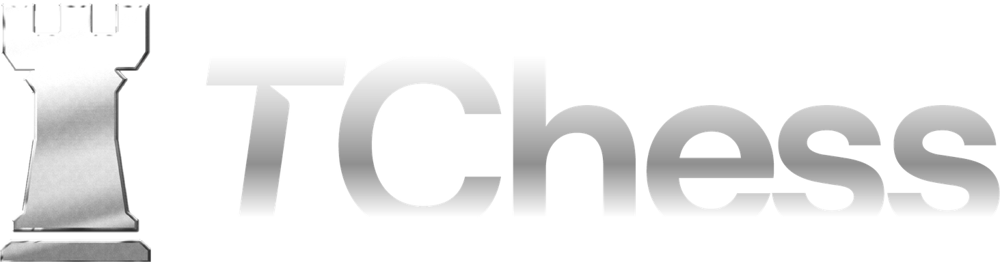
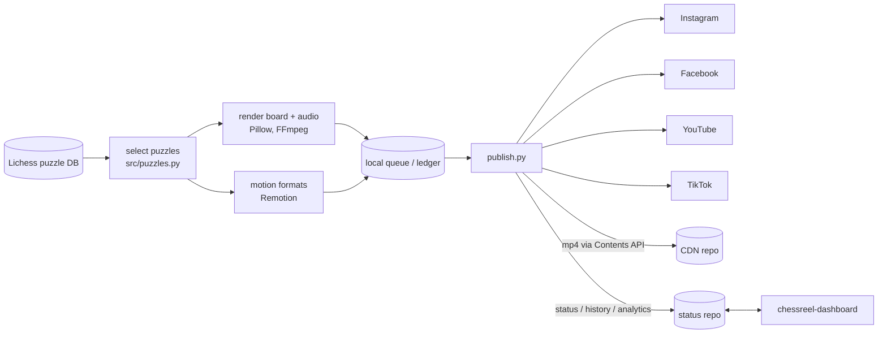

<p align="center"></p>

# chess-reels

Automated pipeline that turns Lichess puzzles into vertical short-form videos
with narration, sound effects and music, then publishes them to Instagram,
Facebook, YouTube and TikTok on a schedule. CPU only: no GPU, no ML training.


It runs the short-form channels for [TChess](https://play.google.com/store/apps/details?id=app.tchess),
an offline chess trainer for Android.

## Features

- **Puzzle selection** from the open [Lichess puzzle database](https://database.lichess.org/#puzzles)
  (CC0), streamed from the CSV and filtered by theme, rating and popularity.
- **Rendering** with python-chess + Pillow: animated board, 3-2-1 countdown,
  move-by-move solution, `!!` badge on the key move, rating reveal. 1080x1920,
  30 fps, H.264 + AAC via FFmpeg.
- **Audio**: neural narration (edge-tts, Piper offline fallback, then SAPI),
  synthesised SFX, and a music bed mixed and ducked per video.
- **Formats**: plain puzzles, sacrifice + reaction cuts, mate-in-two
  challenges, carousels, GM game replays, long-form YouTube videos, and
  motion-graphics promos built with **Remotion**.
- **Captions and titles** written by an LLM (optional; template fallback).
- **Publishing**: Instagram and Facebook through the Graph API, YouTube through
  the Data API, TikTok and Facebook Reels through Playwright driving an
  already signed-in browser profile (no passwords in code). Two brands, each
  with its own schedule, tokens and channel guard.
- **Safety by default**: browser publishing defaults to dry run, new accounts
  and platforms are off until enabled, a YouTube upload refuses to run if the
  token is bound to the wrong channel.
- **Remote control**: status, history and analytics are written as JSON to a
  private GitHub repo, which a separate dashboard reads; pause / resume / run
  now commands flow back the same way.

## Architecture



Status and CDN writes go through the GitHub Contents API with a bot identity
(`chessreel-bot`) as author and committer, so automated commits do not count
as the account owner's activity.

## Getting started

Prerequisites: Python 3.10+, FFmpeg (`ffmpeg` and `ffprobe` on `PATH`), and for
the browser publishers or Remotion formats, Node 18+.

```bash
pip install -r requirements.txt
cp .env.example .env                  # every variable is documented inline

python run_batch.py --smoke --no-api  # build the bundled smoke puzzle, no network
python run_batch.py --count 1         # first real build (downloads the puzzle DB)
python run_batch.py --download-voice  # optional: offline Piper voice
```

More build variants:

```bash
python run_batch.py --count 10 --variant reaction
python run_batch.py --count 5  --variant promo_mate
python make_longform.py --game kasparov-topalov-1999   # one long-form video
cd remotion && npm install && npx remotion studio
```

Publishing:

```bash
python publish.py --dry-run           # resolve what would post, post nothing
python publish.py --account tchessapp # publish as a specific brand
python watcher.py                     # one scheduler tick (control.json, status)
python scripts/verify_accounts.py     # check every token reaches the right account
```

Tests:

```bash
python -m unittest discover -s tests -v
SKIP_SMOKE=1 python -m unittest discover -s tests   # skip the real build
```

### Environment variables

All configuration that identifies an account lives in `.env` (see
`.env.example`): `FB_PAGE_ID`, `FB_PAGE_TOKEN`, `IG_USER_ID`,
`META_BUSINESS_ID`, `YT_CLIENT_SECRET_PATH`, `YT_TOKEN_PATH`, `YT_CHANNEL_ID`,
`TIKTOK_*`, `GITHUB_REPO` / `GITHUB_TOKEN` (CDN), `GITHUB_STATUS_*` (status
repo), `OPENAI_API_KEY`, the `*_TCHESSAPP` variants for the second brand, and
the `*_ENABLED` / `*_DRY_RUN` switches. Non-secret tunables are in `config.py`.

### Media you supply

The repository ships code and the TChess brand assets only. Not included:

- **Music.** Drop your own royalty-free tracks into `assets/music/`; with none,
  the pipeline generates a lo-fi bed. The tracks used in production are not
  distributed because their licences are not redistributable.
- **Reaction clips** (`assets/reactions/`), the **Piper voice model**
  (`--download-voice`), **Remotion promo media** (`remotion/public/`), and the
  **Lichess CSV** (downloaded on first run).
- **Credentials**: `client_secret.json`, OAuth token files and browser profiles
  stay on your machine and are gitignored.

## Project structure

```
run_batch.py       build videos (all short-form variants)
publish.py         post the next due video to every enabled platform
watcher.py         scheduler loop (publishing, analytics, auto-generation)
config.py          tunables and account definitions (no secrets)
src/               puzzles, board render, audio, captions, publishers, status bridge
longform/          long-form YouTube pipeline
browser/           Playwright publishers (Facebook Reels composer, TikTok)
remotion/          motion-graphics and promo formats (React + Remotion)
scripts/           account checks, OAuth helpers, Windows Task Scheduler setup
tests/             unittest suite
docs/              build specification
assets/brand/      logo, wordmark, Sora font
```

## Status

In production, posting several times a day across two brands.

## License

[MIT](LICENSE) for the code. Third-party pieces keep their own licences:
Lichess puzzle data (CC0), Cburnett chess pieces via python-chess (CC BY-SA 3.0), Sora font
(SIL OFL 1.1).

## Author

Taha Ilyas, [github.com/realtahailyas](https://github.com/realtahailyas)
